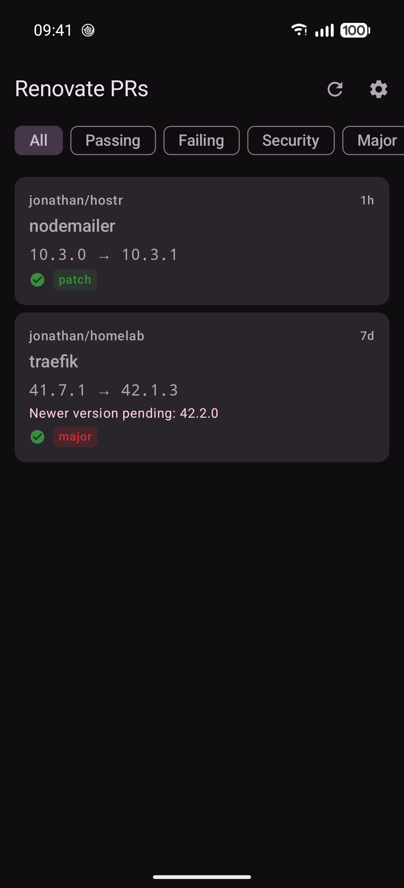
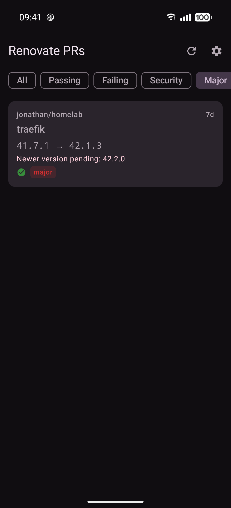
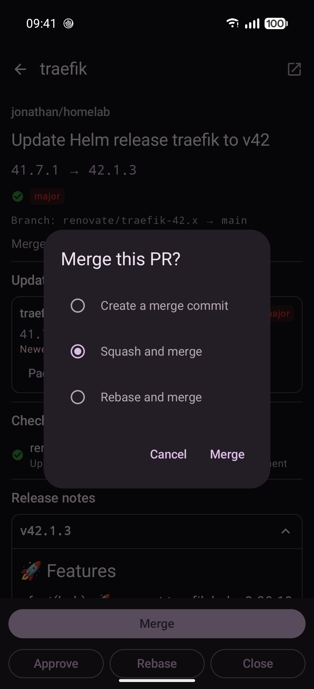

<p align="center">
  
</p>

<p align="center">
  Triage your Renovate pull requests on Forgejo, from your phone.
</p>

---

Mergejo is a native Android app for working through the dependency-update PRs that
[Renovate](https://docs.renovatebot.com/) opens on a [Forgejo](https://forgejo.org/) instance.
It gathers the open Renovate PRs from every repository you have access to into one list.
For each PR it shows what changed, whether CI passed and what the release notes say,
so you can merge, approve, rebase or close it without opening a browser.

## Screenshots

<!--
  Phone screenshots live in docs/screenshots/ (PNG, portrait, straight from the device).
  To add or reorder one, edit the table below; each cell is one screenshot plus a caption.
-->

<table>
  <tr>
    <td align="center" width="33%">
      <br>
      <sub>Every open Renovate PR in one list, security updates first</sub>
    </td>
    <td align="center" width="33%">
      <br>
      <sub>Filter by CI result, security or update type</sub>
    </td>
    <td align="center" width="33%">
      <br>
      <sub>Version changes, CI checks and Renovate's config</sub>
    </td>
  </tr>
  <tr>
    <td align="center">
      <br>
      <sub>Release notes for each version in the jump</sub>
    </td>
    <td align="center">
      <br>
      <sub>Merge with your choice of merge style</sub>
    </td>
    <td align="center">
      <br>
      <sub>Sign in to any Forgejo server with an access token</sub>
    </td>
  </tr>
</table>

## Features

- **One list across all your repos.** Mergejo finds open PRs whose head branch starts with
  `renovate/` in every non-archived repository you can see. Security updates sort first,
  then the newest. Pull down to refresh.
- **Filters:** All, Passing, Failing, Security, Major, Minor and Patch.
- **Detail built from the PR body.** Mergejo reads Renovate's PR template rather than showing
  it as raw markdown. You get the table of packages and versions, security advisories,
  notes about newer pending versions, release notes for each version (long lists collapse),
  links to the package, source, diff and compare pages, and Renovate's schedule, automerge
  and rebase settings for the PR. If a PR body doesn't follow Renovate's template, it's
  shown as plain markdown.
- **CI status** comes from the combined commit status of the PR's head commit, with each
  check listed.
- **Actions:**
  - **Merge** as a merge commit, squash or rebase. You set a default style in Settings and
    can change it for each merge.
  - **Approve** submits an approving review.
  - **Rebase** ticks Renovate's rebase checkbox in the PR body. Renovate rebases the branch
    on its next run.
  - **Close** asks for confirmation first. It warns you if the PR is *immortal*, meaning
    Renovate will open it again on its next run.
- Material 3 with a dark theme, plus dynamic colour on Android 12 and newer.

## Install

CI publishes an APK for every commit to the generic package registry on `cremin.dev`:

```
https://cremin.dev/api/packages/jonathan/generic/mergejo/<commit-sha>/mergejo.apk         # release-shaped
https://cremin.dev/api/packages/jonathan/generic/mergejo/<commit-sha>/mergejo-debug.apk   # debug
```

`mergejo.apk` is the R8-minified `benchmark` build. It is signed with the debug key so it
installs without the release keystore. Tagged builds are published as `mergejo-<tag>.apk`.

The app ID is `dev.cremin.mergejo`. Debug and benchmark builds add `.debug` and
`.benchmark` suffixes, so all three can be installed side by side. Android 8.0 (API 26)
or newer is required.

## Signing in

Mergejo uses a Forgejo personal access token. It doesn't use OAuth.

1. On the sign-in screen, enter your Forgejo server URL. It defaults to `https://cremin.dev`.
2. Tap **Create a token…** to open your server's
   *Settings → Applications* page. Create a token with these scopes:
   - `read:user` — so Mergejo can check the token and show who you are
   - `write:repository` — to list repos and PRs, read CI status, merge and approve
   - `write:issue` — to edit the PR body (rebase) and close PRs
3. Paste the token and sign in.

The token is stored in `EncryptedSharedPreferences` and sent as `Authorization: token …`.
**Settings → Sign out** deletes it.

## Building

The build is Nix-native: the flake's dev shell provides the Android SDK (platform 35,
build-tools 35.0.0) and JDKs 17 and 21. You don't need a system JDK, Android Studio or
global Gradle.

```sh
nix develop -c ./gradlew assembleDebug        # build the debug APK
nix develop -c ./gradlew installDebug         # install on a connected device
nix develop -c ./gradlew testDebugUnitTest    # unit tests
nix develop -c ./gradlew assembleBenchmark    # release-shaped (R8) build, debug-signed
```

Optional settings go in `local.properties`, which isn't committed:

| Key | Purpose |
| --- | --- |
| `FORGEJO_BASE_URL` | Server URL prefilled on the sign-in screen (default `https://cremin.dev`) |
| `RELEASE_STORE_FILE`, `RELEASE_STORE_PASSWORD`, `RELEASE_KEY_ALIAS`, `RELEASE_KEY_PASSWORD` | Release signing; if any is missing, release builds are unsigned |

On NixOS, the flake points AGP at the SDK's `aapt2`, because the `aapt2` that AGP downloads
from Maven won't run there. `gradle.properties` keeps the build to one 1.5 GB JVM so it fits
on small machines.

## Project layout

A single `:app` module with one Activity, Compose navigation, MVVM and Hilt.
`RenovateRepository` sits between the app and the Forgejo API.

```
app/src/main/java/dev/cremin/mergejo/
  data/auth/          token store (EncryptedSharedPreferences) + OkHttp auth interceptor
  data/remote/        ForgejoApi (Retrofit) + Forgejo DTOs
  data/repository/    RenovateRepository: gather → filter renovate/ branches → add CI status → actions
  data/preferences/   SettingsRepository (DataStore)
  domain/             RenovateBodyParser, RenovatePrParser, RenovateMarkdown, RebaseCheckbox
  ui/screen/          login, list, detail, settings (Screen + ViewModel each)
  di/                 Hilt modules
branding/             wordmark and logo sources (SVG)
```

The parser tests run against real Renovate PR bodies saved in
`app/src/test/resources/renovate/`.

## CI

`.forgejo/workflows/build.yml` runs on a self-hosted NixOS Forgejo runner with no Docker.
It runs the unit tests, builds the debug and benchmark APKs, and publishes both to the
package registry.

## Limitations

- Mergejo checks at most 50 repositories, and at most 50 open PRs in each repository.
- It doesn't send notifications, act on several PRs at once, or control Renovate's
  Dependency Dashboard.
