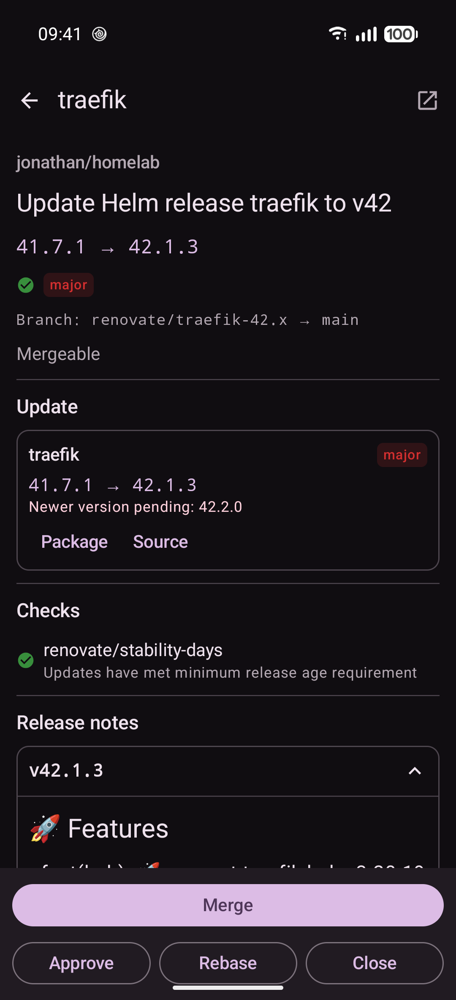
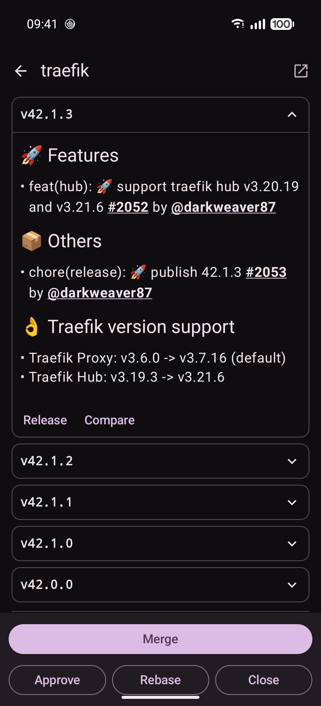
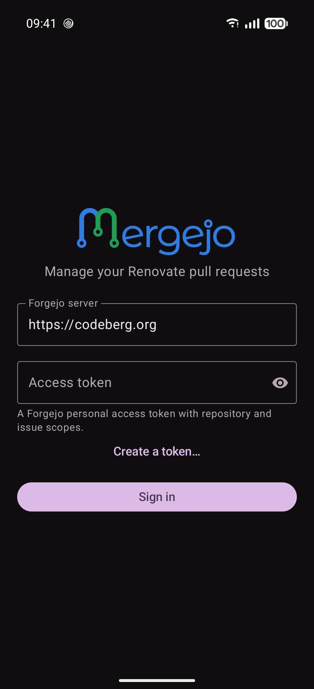

<p align="center">
  
</p>

<p align="center">
  Triage your Renovate pull requests on Forgejo, from your phone.
</p>

---

Mergejo is a native Android app for working through the dependency-update PRs that
[Renovate](https://docs.renovatebot.com/) opens on a [Forgejo](https://forgejo.org/) instance.
It gathers the open Renovate PRs from every repository you have access to into one list.
For each PR it shows what changed, whether CI passed and what the release notes say,
so you can merge, approve, rebase or close it without opening a browser.

## Screenshots

<!--
  Phone screenshots live in fastlane/metadata/android/en-US/images/phoneScreenshots/ (PNG,
  portrait, straight from the device), where F-Droid also reads them; files are numbered in
  store order. To add or reorder one, rename the files and edit the table below to match.
-->

<table>
  <tr>
    <td align="center" width="33%">
      <br>
      <sub>Every open Renovate PR in one list, security updates first</sub>
    </td>
    <td align="center" width="33%">
      <br>
      <sub>Filter by CI result, security or update type</sub>
    </td>
    <td align="center" width="33%">
      <br>
      <sub>Version changes, CI checks and Renovate's config</sub>
    </td>
  </tr>
  <tr>
    <td align="center">
      <br>
      <sub>Release notes for each version in the jump</sub>
    </td>
    <td align="center">
      <br>
      <sub>Merge with your choice of merge style</sub>
    </td>
    <td align="center">
      <br>
      <sub>Sign in to any Forgejo server with an access token</sub>
    </td>
  </tr>
</table>

## Features

- **One list across all your repos.** Mergejo finds open PRs whose head branch starts with
  `renovate/` in every non-archived repository you can see. Security updates sort first,
  then the newest. Pull down to refresh.
- **Filters:** All, Passing, Failing, Security, Major, Minor and Patch.
- **Detail built from the PR body.** Mergejo reads Renovate's PR template rather than showing
  it as raw markdown. You get the table of packages and versions, security advisories,
  notes about newer pending versions, release notes for each version (long lists collapse),
  links to the package, source, diff and compare pages, and Renovate's schedule, automerge
  and rebase settings for the PR. If a PR body doesn't follow Renovate's template, it's
  shown as plain markdown.
- **CI status** comes from the combined commit status of the PR's head commit, with each
  check listed.
- **Actions:**
  - **Merge** as a merge commit, squash or rebase. You set a default style in Settings and
    can change it for each merge.
  - **Approve** submits an approving review.
  - **Rebase** ticks Renovate's rebase checkbox in the PR body. Renovate rebases the branch
    on its next run.
  - **Close** asks for confirmation first. It warns you if the PR is *immortal*, meaning
    Renovate will open it again on its next run.
- **New PR notifications** (off by default). In Settings, choose how often Mergejo checks
  in the background, from every 15 minutes to once a day. Each new Renovate PR gets its own
  notification, and tapping it opens that PR. The first check after you turn this on only
  records the PRs that are already open, so you aren't notified about them. Android may delay
  checks to save battery.
- Material 3 with a dark theme, plus dynamic colour on Android 12 and newer.

## Install

Signed releases are attached to each version on the
[releases page](https://cremin.dev/jonathan/mergejo/releases). The same APKs, with the same
signature, are what F-Droid publishes once Mergejo is accepted there, so you can switch between
the two without reinstalling.

CI also publishes a test APK for every commit to the generic package registry on `cremin.dev`:

```
https://cremin.dev/api/packages/jonathan/generic/mergejo/<commit-sha>/mergejo.apk         # release-shaped
https://cremin.dev/api/packages/jonathan/generic/mergejo/<commit-sha>/mergejo-debug.apk   # debug
```

`mergejo.apk` is the R8-minified `benchmark` build. It is signed with the debug key so it
installs without the release keystore. These are for testing and can't update a signed
release install, or the reverse.

The app ID is `dev.cremin.mergejo`. Debug and benchmark builds add `.debug` and
`.benchmark` suffixes, so all three can be installed side by side. Android 8.0 (API 26)
or newer is required.

## Signing in

Mergejo uses a Forgejo personal access token. It doesn't use OAuth.

1. On the sign-in screen, enter your Forgejo server URL. It defaults to `https://codeberg.org`.
2. Tap **Create a token…** to open your server's
   *Settings → Applications* page. Create a token with these scopes:
   - `read:user` — so Mergejo can check the token and show who you are
   - `write:repository` — to list repos and PRs, read CI status, merge and approve
   - `write:issue` — to edit the PR body (rebase) and close PRs
3. Paste the token and sign in.

The token is stored in `EncryptedSharedPreferences` and sent as `Authorization: token …`.
**Settings → Sign out** deletes it.

## Building

The build is Nix-native: the flake's dev shell provides the Android SDK (platform 35,
build-tools 35.0.0) and JDK 21. You don't need a system JDK, Android Studio or
global Gradle.

```sh
nix develop -c ./gradlew assembleDebug        # build the debug APK
nix develop -c ./gradlew installDebug         # install on a connected device
nix develop -c ./gradlew testDebugUnitTest    # unit tests
nix develop -c ./gradlew assembleBenchmark    # release-shaped (R8) build, debug-signed
```

Optional settings go in `local.properties`, which isn't committed:

| Key | Purpose |
| --- | --- |
| `FORGEJO_BASE_URL` | Server URL prefilled on the sign-in screen (default `https://codeberg.org`) |
| `RELEASE_STORE_FILE`, `RELEASE_STORE_PASSWORD`, `RELEASE_KEY_ALIAS`, `RELEASE_KEY_PASSWORD` | Release signing; if any is missing, release builds are unsigned |

On NixOS, the flake points AGP at the SDK's `aapt2`, because the `aapt2` that AGP downloads
from Maven won't run there. `gradle.properties` keeps the build to one 1.5 GB JVM so it fits
on small machines.

## Project layout

A single `:app` module with one Activity, Compose navigation, MVVM and Hilt.
`RenovateRepository` sits between the app and the Forgejo API.

```
app/src/main/java/dev/cremin/mergejo/
  data/auth/          token store (EncryptedSharedPreferences) + OkHttp auth interceptor
  data/remote/        ForgejoApi (Retrofit) + Forgejo DTOs
  data/repository/    RenovateRepository: gather → filter renovate/ branches → add CI status → actions
  data/preferences/   SettingsRepository (DataStore)
  domain/             RenovateBodyParser, RenovatePrParser, RenovateMarkdown, RebaseCheckbox, NewPrDetector
  notifications/      background poll (WorkManager + Hilt): scheduler, worker, notifier
  ui/screen/          login, list, detail, settings (Screen + ViewModel each)
  di/                 Hilt modules
branding/             wordmark and logo sources (SVG, CC BY-SA 4.0; see branding/README.md)
fastlane/             store listing read by F-Droid: descriptions, icon, screenshots, changelogs
```

The parser tests run against real Renovate PR bodies saved in
`app/src/test/resources/renovate/`.

## CI

`.forgejo/workflows/build.yml` runs on a self-hosted NixOS Forgejo runner with no Docker.
It runs the unit tests, builds the debug and benchmark APKs, and publishes both to the
package registry.

## Releasing

Releases are [reproducible](https://f-droid.org/docs/Reproducible_Builds/). F-Droid builds each
tag itself, checks the result matches the signed APK attached to the release byte for byte,
and then publishes that signed APK.

1. Bump `versionCode` and `versionName` in `app/build.gradle.kts`, and add
   `fastlane/metadata/android/en-US/changelogs/<versionCode>.txt` (500 characters at most).
2. Commit, tag `v<versionName>` on that commit, and push the commit and the tag.

CI then takes over. After the usual build and tests, the `release` job runs
[`scripts/release.sh`](scripts/release.sh). The script checks that the tag matches `versionName`
and the changelog exists. It builds and signs the release APK, and refuses to continue unless the
APK is signed with the release key. Then it creates the Forgejo release, with the changelog as
release notes, and attaches the APK as `mergejo-<versionName>.apk`. If the job fails, re-run it
from the Actions tab; the script skips steps that are already done.

The job needs three repository secrets (Settings → Actions → Secrets):

| Secret | Value |
| --- | --- |
| `RELEASE_KEYSTORE_BASE64` | the keystore, base64-encoded (`base64 -w0 mergejo-release.jks`) |
| `RELEASE_STORE_PASSWORD` | the keystore password |
| `RELEASE_KEY_PASSWORD` | the key password |

To release by hand instead, run the same script from a clean, normal checkout of the tag (not a
git worktree, since AGP records the commit in the APK), with signing configured in
`local.properties` and a Forgejo token that can write to the repository:
`FORGEJO_TOKEN=… nix develop -c bash scripts/release.sh`. Without a token, it only builds and
checks `mergejo-<versionName>.apk`.

F-Droid notices new tags on its own (`UpdateCheckMode: Tags`). It fetches the APK from
`https://cremin.dev/jonathan/mergejo/releases/download/v<versionName>/mergejo-<versionName>.apk`,
so the file name matters.

## Limitations

- Notifications come from polling, not push, so they arrive on the next check rather
  than straight away, and WorkManager won't check more often than every 15 minutes.
- It can't act on several PRs at once or control Renovate's Dependency Dashboard.

## Issues

Report bugs and request features at
[github.com/kudos/mergejo/issues](https://github.com/kudos/mergejo/issues). The GitHub
repository is a mirror of the main one at [cremin.dev](https://cremin.dev/jonathan/mergejo),
which doesn't accept new sign-ups.

## License

The code is released under the [MIT licence](LICENSE).

The Mergejo logo and wordmark are an unofficial modification of the
[Forgejo logo](https://codeberg.org/forgejo/governance/src/branch/main/branding#logo) by
[Caesar Schinas](https://caesarschinas.com/), and like the original are licensed under
[CC BY-SA 4.0](https://creativecommons.org/licenses/by-sa/4.0/). See
[`branding/README.md`](branding/README.md) for details.

Mergejo is an independent project. It is not affiliated with or endorsed by the Forgejo project.
